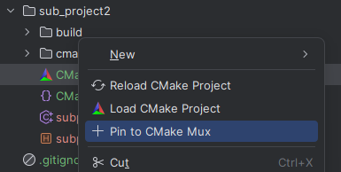
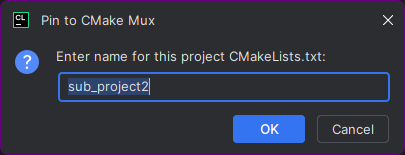
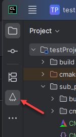
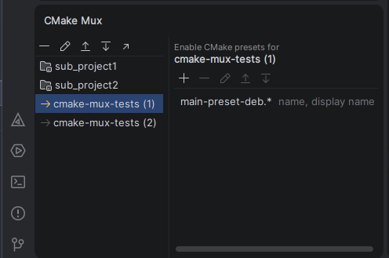
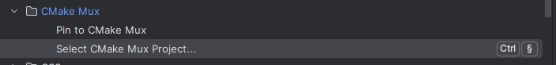
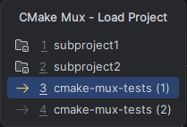

# CLion CMake Mux Plugin

## Overview

This plugin enables quick CMake project switching in CLion via:

- Project tool window context action for any CMakeLists.txt, “Pin to CMake Mux”
- New CMake mux panel to manage pinned projects
- Popup action to easily switch projects via keyboard shortcuts
- Automatic CMake preset enabling for selected projects

All this enables switching between multiple CMake projects more convenient compared to the standard CLion experience.

## Background

By default, CLion uses the `CMakeLists.txt` in your project root as the top-level CMake file. To switch, you can
right‑click another `CMakeLists.txt` and choose “Load CMake Project.” If you switch frequently, repeating this manual
step becomes tedious.

This plugin adds a shortlist of user-defined projects. Double‑click any item to load it (equivalent to “Load/Reload
CMake Project”).

Additionally, while CLion automatically imports any CMake presets it finds for a particular project location, they start
disabled. The plugin lets you define regular expressions per project shortcut to automatically enable matching presets
after switching.

## Details

When you right‑click any `CMakeLists.txt`, the plugin provides a “Pin to CMake Mux” in the context menu.

Adding a `CMakeLIsts.txt` to the mux requires a unique nickname. The same `CMakeLists.txt` can be pinned several
times, e.g. a top-level `CMakeLists.txt` with different presets enabled for each pin:

The plugin also provides a panel where you can manage your pinned CMake projects.

The panel lists pinned projects. Double‑click any project to load it using CLion’s “Load CMake Project.”

The active project is highlighted with a yellow arrow: its `CMakeLists.txt` is loaded and the enabled presets are
exactly the ones selected by its regular expressions. A gray arrow means that only the `CMakeLists.txt` is known to be
loaded, e.g. when it was loaded with CLion's own “Load CMake Project” or the enabled presets were changed by hand. The
arrows are updated whenever CLion loads a CMake project or the presets change, also at IDE startup, where CLion itself
restores the last loaded project and presets.

The “Enable CMake presets for <project>” panel lets you specify any number of regular expressions; presets whose names
match are enabled automatically. Double-click a regular expression (or use the edit button) to edit it. For each
regular expression you choose whether it is matched against the preset name, the display name, or both. Matching is
case-insensitive and a match anywhere in the name is enough, use `^...$` to match the whole name (e.g. `.*` enables
all presets, `^debug$` only the preset named `debug`).

Switching between two pins of the `CMakeLists.txt` that is already loaded does not reload the project. Instead, the
presets matching the new pin are enabled and all other presets are disabled. Loading a pin always enables exactly the
presets selected by its regular expressions. Double-clicking the active pin reloads the project.

While a pin is active (yellow arrow), its name is shown in the status bar at the bottom right. Hovering shows the
`CMakeLists.txt` path, clicking it opens the CMake Mux tool window. The status bar entry can be hidden via the status
bar context menu.

The action “Select CMake Mux Project...” can be bound to a custom keyboard shortcut.

Invoking the action/shortcut shows a popup with the first nine pinned projects. Press a digit to load the corresponding
project, or use the arrow keys and Enter. Invoking the action/keyboard shortcut again will cycle through the next
projects in the list.

> [!NOTE]
> The plugin has no additional settings panel. It simply extends the CLion UI to streamline
> multi‑project CMake workflows.

## Future

The plugin will receive updates as long as CLion/Jetbrains continue to support the APIs and hooks used by the plugin.
And if Jetbrains ever decides to add a similar features to CLion, this plugin will be obsolete. See
this [feature request](https://youtrack.jetbrains.com/issue/CPP-1537) for more details.
